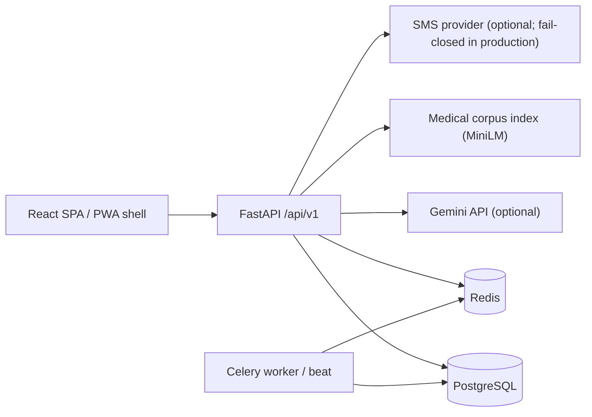

# NurtureHer AI

NurtureHer is a full-stack maternal and women's health platform built with FastAPI, SQLAlchemy 2.0, React, TypeScript, Vite, and Tailwind CSS. It combines health tracking, screening support, consent-based care sharing, clinician workflows, and a retrieval-augmented AI coach.

> **Current status:** this README and the documentation pack were audited against the repository on 2026-10-21. The working tree contains substantial uncommitted work on `integration/gayathri-features`. Treat source code as authoritative and verify Git state before using older reports.
>
> Screening outputs and chatbot answers are decision-support aids, not diagnoses. They have not been clinically validated and must not be presented as medical advice, regulatory approval, or production certification.

## Documentation Map

| Document | Purpose |
| --- | --- |
| [`docs/README.md`](docs/README.md) | Documentation index and evidence/status legend |
| [`docs/PROJECT_MEMORY.md`](docs/PROJECT_MEMORY.md) | Canonical project handover and recovery record |
| [`docs/SESSION_START_HERE.md`](docs/SESSION_START_HERE.md) | Fast start for a fresh developer or AI session |
| [`docs/AUTH_AND_RBAC.md`](docs/AUTH_AND_RBAC.md) | Authentication, roles, consent, and authorization behavior |
| [`docs/RAG_RUNBOOK.md`](docs/RAG_RUNBOOK.md) | Corpus, retrieval, chat flow, safety escalation, and operations |
| [`docs/DEVELOPMENT_RUNBOOK.md`](docs/DEVELOPMENT_RUNBOOK.md) | Local setup, Docker caveats, tests, and troubleshooting |
| [`docs/IMPLEMENTATION_STATUS.md`](docs/IMPLEMENTATION_STATUS.md) | Verified feature status, known gaps, and unresolved claims |
| [`docs/architecture.md`](docs/architecture.md) | Short architecture overview |
| [`docs/environment_variables.md`](docs/environment_variables.md) | Environment variable names and expected behavior |
| [`docs/PWA.md`](docs/PWA.md) | PWA caching and verification behavior |

## Main Capabilities

- **Mother portal:** mood, symptom, cycle, and journal tracking; PCOS and PPD screening support; AI health coach; nutrition and hydration; reports; CareCircle QR consent sharing.
- **Caregiver hub:** educational content and consent-filtered access to a mother's shared summary, nutrition, and optionally chat history.
- **Doctor portal:** consent-authorized patient roster, timeline, clinical notes, shared chat history, nutrition plan review, and escalation queue. Administrators can access the doctor view.
- **Admin portal:** user counts and account updates, audit-log viewing, and operational summaries. Admin access is intentionally separate from the public login portals.
- **HerReach:** healthcare facility search and official helpline information. Live place search requires a Google Places API key; otherwise the service returns Google Maps deep links and clearly reports the degraded state.
- **PWA shell:** installable app shell with offline UI, but no offline clinical data or API responses.

## Roles and Login Behavior

The application roles are `mother`, `caregiver`, `doctor`, and `admin`.

- Public login offers mother, doctor, and caregiver portals. The selected portal must match the account role.
- Doctor and admin self-registration is disabled. A doctor account also requires `is_verified=true` before login or API use.
- Administrator login is available at `/internal/admin/login`.
- The `/demo` page provides shortcuts for the three public demo roles. It is separate from the login page and does not include an admin shortcut.
- Demo records are created by `scripts/seed.py`. Set `NURTUREHER_DEMO_PASSWORD` before seeding; credentials are deliberately not listed in this repository documentation. Do not use demo credentials outside local demonstration environments.

## Architecture



The backend uses PostgreSQL in Docker/production. SQLite is used when the configured database host is Docker's `db` host and that host is unreachable; PostgreSQL on `localhost` does not automatically fall back. See [`docs/DEVELOPMENT_RUNBOOK.md`](docs/DEVELOPMENT_RUNBOOK.md).

The chat pipeline is safety-first and deterministic at the escalation layer: urgent/crisis screening, conversational intent routing, triage, corpus-first retrieval with an evidence gate, v1 knowledge-base fallback, Gemini generation, citation validation, disclaimer enforcement, and persistence. The LLM does not decide whether an emergency exists.

## Quick Start

### Prerequisites

- Python 3.11 (the container and project target; 3.12 is not verified)
- Node.js 20.19+ or 22.12+ (required by Vite 8)
- PostgreSQL 16 and Redis 7 for the full stack, or Docker Desktop
- A virtual environment is strongly recommended

### Local backend with Docker dependencies

The hostnames in `.env.example` are Docker service names. For a backend running on the host, start PostgreSQL and Redis with Compose and change the service hostnames in your local `.env` to `localhost`.

```powershell
docker compose -f docker-compose.yml up -d db redis
if (-not (Test-Path .env)) { Copy-Item .env.example .env }
# In .env, change the @db database hosts and the redis host to localhost.
python -m venv venv
.\venv\Scripts\Activate.ps1
pip install -r requirements.txt
alembic upgrade head
$env:NURTUREHER_DEMO_PASSWORD = "<choose-a-local-demo-password>"
python scripts/seed.py
python -m uvicorn app.main:app --host 127.0.0.1 --port 8000 --reload
```

- API: `http://127.0.0.1:8000`
- Swagger UI: `http://127.0.0.1:8000/docs`
- Health: `http://127.0.0.1:8000/health`

Alembic uses `SYNC_DATABASE_URL` and has no SQLite fallback. If you leave `.env.example` hostnames unchanged without a Compose `db` service, the app runtime can fall back to `nurtureher.db`, but `alembic upgrade head` will fail. Use PostgreSQL for anything beyond a throwaway smoke test. Do not commit `.env` or a real API key; `.env.example` contains placeholders.

### Local frontend

```powershell
Set-Location frontend
npm install
npm run dev
```

Open `http://localhost:5173`. The frontend defaults to `http://localhost:8000/api/v1`; override it with `VITE_API_BASE_URL` when needed.

### Docker

The default `docker compose up --build` also loads `docker-compose.override.yml`, which runs the API and workers with `ENVIRONMENT=production` and production start scripts. This is not a no-configuration development mode. For local development without the override, use:

```powershell
docker compose -f docker-compose.yml up --build
```

Read [`docs/DEVELOPMENT_RUNBOOK.md`](docs/DEVELOPMENT_RUNBOOK.md) before using production Compose or Kubernetes manifests.

## Configuration and Secret Handling

Configuration is environment-driven. Do not put credentials, tokens, patient information, or raw chat content in source files or documentation.

- `GEMINI_API_KEY`: optional; without it the chat service uses its local fallback response.
- `GOOGLE_MAPS_API_KEY`: optional; required for live HerReach place search.
- `NURTUREHER_DEMO_PASSWORD`: local seed password for demo accounts; never reuse it as a real password.
- `VITE_API_BASE_URL`: frontend API base URL.
- `VITE_DEMO_*`: optional overrides for the demo page; do not commit their values.

A secret-like, truncated Gemini key fragment was present in an older version of this README. It has been removed and is not reproduced here. If that fragment came from a real key, revoke or rotate the key in the Google Cloud console. Do not rotate credentials as part of a documentation-only change.

See [`docs/environment_variables.md`](docs/environment_variables.md) for the full name-level reference and production notes.

## Testing and Verification

Backend:

```powershell
python -m pytest -q
```

The repository-wide test configuration enforces a coverage gate of 80%. Targeted subsets can be run without that gate for focused checks:

```powershell
python -m pytest tests/test_auth_portals.py tests/test_chat_corpus_integration.py --no-cov -p no:cacheprovider -q
```

Frontend:

```powershell
Set-Location frontend
npm run test
npx tsc -b
npm run lint
npm run build
```

Historical test counts are recorded in [`docs/IMPLEMENTATION_STATUS.md`](docs/IMPLEMENTATION_STATUS.md) and are not presented as current verification. No live Gemini evaluation, full browser/PWA matrix, or production deployment is claimed here.

## Clinical and Compliance Boundaries

- PCOS, PPD, cycle, triage, and safety outputs are risk-support or educational content, not diagnostic conclusions.
- Safety templates, triage rules, retrieval thresholds, and clinical content are marked pending clinical/native-language review unless explicitly stated otherwise.
- Audit logs and consent controls support safe operation but do not by themselves establish HIPAA, DPDP, or any other regulatory compliance.
- Emergency numbers and links are informational; the application does not dispatch emergency services.

## License

See `LICENSE` in the repository root.
