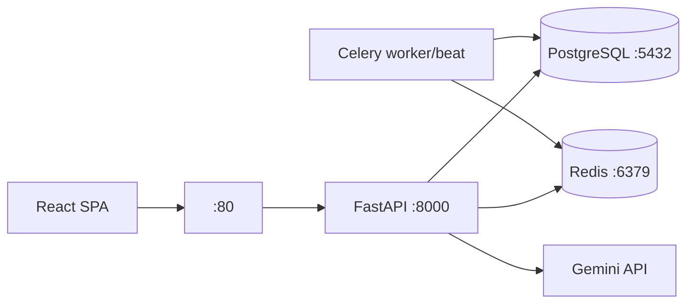

# NurtureHer — Project Memory (Master Record)

> **Authority rule:** repository code is the authority for current implementation. Statuses are tagged **verified-in-repo** (read from source), **previously-reported** (session history, not re-run here), or **planned** (approved, not implemented). Git history is a single commit; "verified-via-git" rarely applies. Never claim clinical validation, medical accuracy, production readiness, or regulatory compliance.

## Table of contents

1. [Project identity](#1-project-identity-and-purpose)
2. [Application architecture](#2-complete-application-architecture)
3. [Feature inventory](#3-complete-feature-inventory)
4. [Development history](#4-project-development-history-and-changes)
5. [Git workflow](#25-git-workflow-and-collaboration)
6. [Environment and setup](#26-developer-environment-and-setup)
7. [Testing history](#27-testing-and-verification-history)
8. [Troubleshooting](#28-bugs-incidents-and-troubleshooting-history)
9. [RAG summary](#29-rag-summary) → full detail in [RAG_ARCHITECTURE.md](./RAG_ARCHITECTURE.md)
10. [Current status, pending tasks, decisions](#210-current-status-pending-tasks-decisions)
11. [Operating rules](#211-operating-rules-for-future-sessions)

---

## 1. Project identity and purpose

**NurtureHer** is an AI-powered women's health and postpartum-support platform (FastAPI backend + React 18 SPA). Intended users: mothers/patients, caregivers, ASHA/ANM community workers (role removed from app — see §4), and doctors, plus admins. Product capabilities: maternal wellness tracking (mood, symptoms, cycle, journal), PCOS screening, PPD screening (EPDS), AI health chatbot with RAG, cycle prediction, nutrition/hydration, caregiver content, CareCircle QR consent sharing, doctor portal, emergency SOS info, reports.

**AI role:** (a) PCOS RandomForest screening model (9 features, test accuracy 0.975 per artifact metadata — previously reported, artifact not re-validated here); (b) RAG chatbot (Gemini generation over curated knowledge + user context). **Screening ≠ diagnosis** — outputs are risk estimates requiring clinical confirmation; UI/PDF disclaimers state this.

**Feature maturity:** implemented (auth, trackers, screenings, chat v1, dashboards, CareCircle, reports); partially implemented (multilingual chat quality, voice — browser-only, mock backend endpoints); experimental (RAG v2 — isolated, unwired); planned (RAG remediation phases, threads, corpus expansion).

---

## 2. Complete application architecture

### Frontend (`frontend/`, React 18.3.1 + Vite 8.1.3 + TS)
- **Entry:** `src/main.tsx` → QueryClient (60s stale) > ThemeProvider > AuthProvider > LanguageProvider > BrowserRouter > `App`.
- **Routing** (`src/App.tsx`): unauthenticated branch (`/login`, `/register` → `AuthPage`; `*` → lazy `LandingPage`); authenticated `AppShell` + role home (`doctor→DoctorDashboard`, `admin→AdminDashboard`, `caregiver→CaregiverPage`, else `Dashboard`); routes `/doctor /admin /dashboard /insights /coach /chat-history /cycle /pcos /ppd /journal /nutrition /doctor-visit /carecircle /caregiver /emergency /reports /profile /settings /logout`, plus `/login|/register → Navigate /` guards. All lazy + Suspense except AuthPage. No per-route guards beyond global auth check.
- **Pages** (`src/pages/`): `AuthPages` (login/register + role select + 5 demo accounts — historical; ASHA demo removed per §4), `Dashboard` (mother), `DoctorDashboard` (roster/timeline/notes), `AdminDashboard` (users/audit/model metrics), `ClinicalPages.tsx` (`PCOSPage`, `PPDPage`, `CyclePage`, `EmergencyPage` — static `tel:112/108/104` buttons, no maps/geolocation), `Coach.tsx` (chat bubbles, ReactMarkdown, Web Speech STT/TTS, hardcoded EN strings noted), `NutritionPage`, `ReportsZone` (PDF/CSV via `lib/reportPdf.ts`), `DoctorVisitAssistant`, `CareCircleQR`, `CaregiverPage`, `SupportPages` (Insights/Journal/ChatHistory/Profile/Settings/Logout/NotFound), `landing/` (LandingPage + sections + content + CSS).
- **API client** (`src/lib/api.ts`): `VITE_API_BASE_URL ?? localhost:8001/api/v1`, `sessionStorage` tokens, 401-refresh retry; typed `api.*` per module + `uploadVoice`.
- **State/forms:** React Query + local state; React Hook Form + schema validation (ClinicalPages tests reference `pcosSchema`); `LanguageContext` (`localStorage:nurtureher_language`, `en/hi/kn/ta/te/ml`, default `en`); `ThemeContext`; `AuthContext` (`api.me/login/register/logout`).
- **Styling:** Tailwind + shadcn/Radix primitives (`components/ui/`), `components/common/` (Page, Premium, InfoBlocks, FormField...), `components/charts/` (recharts), `src/index.css` utilities; landing has separately scoped CSS. No global CSS framework conflicts noted.
- **Build/test:** `npm run dev|build (tsc -b && vite build)|preview|lint (eslint --max-warnings 0)|test (vitest run, jsdom)`. Tests: `App.routing`, `ClinicalPages`, `LandingPage` (.test.tsx).

### Backend (`app/`, FastAPI 0.111, Python 3.11)
- **Entry:** `app/main.py` — `app.include_router(api_router, prefix=/api/v1)`; middleware (SlowAPI 100/min global, Prometheus metrics, logging, request-tracking, auth-context, audit, sanitization, CORS); handlers (`RateLimitExceeded`, `AppError→400`, validation→422, integrity→409); lifespan `create_all + close_redis()`; `GET /, /health, /metrics`; Sentry optional. Prod entry `app/production_main.py` (+`/live`, `/ready`, `/metrics/infra`, gzip, security headers).
- **Routers** (`app/api/routes/`, all verified): `auth` (register/login/me), `wellness` (mood/journal/dashboard), `cycle` (CRUD + prediction), `pcos` (predict/history), `ppd` (assessment/history), `chat` (message/voice/history; TTS present per audit — verify before relying), `caregiver`, `carecircle` (QR TrustVault), `doctor` (patients/timeline/notes), `nutrition`, `admin` (dashboard/users/audit-logs), `notifications`. Legacy mirrors in `app/api/*.py` exist but are **not mounted** — do not import them.
- **Services** (`app/services/`, 29 files incl. shims): `AuthService`, `ChatbotService` (=`ChatService` alias in `health.py`), `PCOSService`, `PPDService`, `WellnessService`/`CycleService`, `TokenService` (Redis refresh rotation), `GeminiService` (temp 0.3, 512 tokens, 20s timeout, 4-model fallback chain), voice STT/TTS, `PPDRiskDetectionService`/`EPDScoringEngine`, `sentiment/translation/memory/rag/risk/risk_engine/alert/notification/sms_provider/safety`.
- **Schemas** (`app/schemas/`): `ChatRequest{message[1..5000], language} → ChatRead`; `PCOSPredictRequest{age,bmi,cycle∈{2,4},cycle_length,weight_gain,hair_growth,skin_darkening,hair_loss,pimples} → {risk_level,probability,recommendations}`; `PPDAssessmentRequest{answers[10×0..3],journal_text}`; auth/mood/symptom/journal/cycle/alert/high-risk DTOs.
- **Models** (20 tables): `users`, `mother_profiles`, `moods`, `symptoms`, `cycles`, `journals`, `pcos_predictions`, `ppd_assessments`, `chat_messages`, `caregiver_content`, `high_risk_cases`, `alerts`, `audit_logs`, `refresh_tokens`, `carecircle_qrs`, `carecircle_access`, `doctor_patients`, `doctor_notes`, `nutrition_plans`, `hydration_logs` (+ enums `CaseStatus`, `RiskLevel`). Roles: mother/caregiver/doctor/admin (ASHA removed; migration `0003` deactivates legacy rows, preserves them).
- **Auth:** bcrypt (72B truncation) + `CryptContext`; jose HS256 JWT with type-checked access/refresh + jti; `get_current_user` + `require_roles(...)`; chat endpoints use identity-only auth (any authenticated role; user_id from token — no spoofable role param).
- **Config** (`app/core/config.py`, names only): project/environment/api-prefix, database/sync URLs, redis/celery URLs, JWT/encryption keys + expiries (30min/7d), CORS origins, `pcos_model_path`, `gemini_api_key/_model`, SMS provider keys, metrics/log/sentry flags. Values live in `.env` (never read into docs).
- **Validation/errors/logging/health:** Pydantic v2 schemas; `register_exception_handlers`; struct-ish logging; `/health`, `/live`, `/ready` (DB `SELECT 1` + Redis ping), `/metrics`.
- **External integrations:** Gemini (`httpx`), Twilio/Fast2SMS (fail-closed in prod), Google Fonts (frontend link), emergency numbers as static `tel:` links (no dispatch integration).
- **Start/test:** `uvicorn app.main:app`, `alembic upgrade head`, `pytest` (asyncio auto, coverage gate 80%, omits api/services/repos/workers), `ruff` (line-length 140, py311).

### Database and background processing
- PostgreSQL 16 (asyncpg; SQLite `nurtureher.db` local fallback — binary, not parsed) via SQLAlchemy 2.0 `AsyncSessionLocal`; Alembic at `database/alembic` (`0001_initial` 14 tables+enums, `0002_production_indexes`, `0003_deactivate_asha_role` — deactivates legacy `ASHA_WORKER` rows, adds missing `DOCTOR` enum label, `0004_add_carecircle_tables` — CareCircle/doctor tables + chat-history scope, `0005_role_specific_nutrition` — consent-scoped nutrition profiles and care plans (renumbered from `0004_role_specific_nutrition` during the integration/gayathri-features merge)); workflow per `docs/migration_strategy.md` (never edit applied migrations; revision IDs must fit `alembic_version.version_num VARCHAR(32)`).
- Redis: chat memory (`chat-memory:{user}`, 20 turns/1h TTL, fail-open), refresh rotation, dashboard cache, HTTP cache (`SafeRedis` wrappers); Celery worker + beat (300s heartbeat, 3600s expiry) for SMS alerts, health checks, alert expiry. No migration/concurrency issues verified; none claimed.

### Infrastructure
- `Dockerfile` (dev: `alembic upgrade head && uvicorn`), `Dockerfile.prod` (multistage, non-root `appuser`, `curl /ready` healthcheck, `start_api.sh`); compose: dev 4 services (api:8000, worker, db:5432, redis:6379), override adds beat + DB tuning, prod 7 services (+nginx:80, prometheus:9090, grafana:3000, volumes `postgres_data/redis_data`, `restart:unless-stopped`).
- Nginx proxies `/health` + `/` with rate limiting; K8s manifests under `deployment/k8s/` (presence verified, contents not deeply inspected — marked accordingly).

---

## 3. Complete feature inventory

| Feature | Purpose | Status | Frontend | Backend | Endpoints/Models | AI | Tests | Defects/limits → Remaining work |
|---|---|---|---|---|---|---|---|---|
| Auth + users | Register/login/JWT, 4 roles | implemented | AuthPages, AuthContext | `auth.py` routes+service, `security.py`, `TokenService` | `/auth/*`, `users`, `refresh_tokens` | — | `test_security`, routing tests | Legacy ASHA rows deactivated via 0003; verify login rejection manually |
| PCOS screening | 9-field risk estimate | implemented | `ClinicalPages.PCOSPage` | `pcos.py`, `prediction_service.py`, RF artifact (acc 0.975 per metadata) | `/pcos/*`, `pcos_predictions` | RF model | `test_pcos_nine_field`, `test_ml` | UI-label-vs-artifact question unverified |
| PPD screening | EPDS + sentiment | implemented | `ClinicalPages.PPDPage` | `ppd.py`, `ppd_service`, `scoring_engine`, `sentiment` (EN lexicon) | `/ppd/*`, `ppd_assessments` | lexicon | `test_integrations` (EPDS=10) | Non-English sentiment always neutral |
| Chatbot + history | RAG health coach | implemented (v1) | `Coach.tsx`, ChatHistoryPage | `chat.py`, `chat_service`, RAG, Gemini | `/chat/*`, `chat_messages` | Gemini+RAG | `test_chat_*` (4 files) | EN-only KB; mock voice; see §9 |
| Cycle tracking | Logging + prediction | implemented | `CyclePage` | `cycle.py`, `CycleService` | `/cycle/*`, `cycles` | date math | `test_ml` (date) | — |
| Mood/symptoms/journal | Daily tracking | implemented | Dashboard, JournalPage | `wellness.py` | `/wellness/*`, `moods/symptoms/journals` | — | — | — |
| Nutrition/hydration | Plans + water log | implemented | NutritionPage | `nutrition.py` | `/nutrition/*` | — | — | Guide copy notes missing endpoints |
| Caregiver hub | Videos/tips | implemented | CaregiverPage | `caregiver.py` | `caregiver_content` | — | — | — |
| CareCircle QR | Consent sharing | implemented | CareCircleQR | `carecircle.py` | `carecircle_qrs/access` | — | — | — |
| Doctor portal | Roster/timeline/notes | implemented | DoctorDashboard | `doctor.py` | `doctor_patients/notes` | — | — | — |
| Admin | Users/audit/model metrics | implemented | AdminDashboard | `admin.py` | `audit_logs` | — | `test_app` routes | — |
| Landing | Marketing homepage | implemented | `landing/*` | — (static) | — | quiz/modal (local state) | `LandingPage.test` | Mockup-derived; reference kept at `frontend/public/landing-new/` |
| Emergency | SOS info | static only | EmergencyPage (`tel:` links) | none | none | — | — | No dispatch integration (by design) |
| Reports | PDF/CSV export | implemented | ReportsZone, `reportPdf.ts` | `wellness.py` summaries | — | — | — | — |
| RAG v2 | Experimental successor | experimental, unwired | none | `app/rag_v2/` (10 modules) | none | MiniLM+MPNet adapters | 5 rag_v2 suites | See §9 + RAG_ARCHITECTURE |
| Hospital/directions | — | **not present** | only static helplines | none | none | — | — | Do not claim it exists |

---

## 4. Project development history and changes

Tiers: **[V-repo]** verified in current source this task · **[V-git]** single commit only · **[H]** previously reported, not re-verified · **[P]** planned.
- **[H]** ASHA Worker role removal: enum member deleted, `/asha` routes + `AshaService` + dashboard removed, demo/seed/register entries removed, migration `0003` deactivates (not deletes) legacy rows, `test_asha_removal.py` added. Verified present: `0003_*.py` file, `UserRole` 4 members, `test_asha_removal.py` exists. Test outcomes: **[H]**.
- **[H]** Landing integration: `landing/` React conversion of `frontend/public/landing-new/Main.dc.html` mockup; `landing-new/` reference retained. Verified present: both directories exist.
- **[H]** Auth redesign: scoped `AuthPages.css` (`.nh-auth`), body-bg class toggle; verified: files exist (content not re-read here).
- **[H]** RAG Phase 1+2: safety module + pending-review templates, disclaimer helper, citation markers, evidence gating, threshold 0.30 default, Gemini query translation, 6-language dict; 12 backend files show as **uncommitted modifications** (see §5) — consistent with this history.
- **[H]** RAG P1–P3 (experimental): `app/rag_v2/` created, benchmark (MiniLM recall@1≈0.182 vs MPNet≈0.636 — historical numbers), calibration (cutoffs 0.254/0.35 — values verified present in `thresholds.json`), MPNet revision recorded in benchmark report (hash not re-verified here — marked accordingly).
- **[V-git]** One commit total: `2ebd7ec Initial commit: NurtureHer Lilac`; all session work uncommitted.
- **[V-repo]** Docs inventory: 18 Markdown files incl. 2026-09-02 project audit, 2026-07-09 readiness report, RAG benchmark/threshold reports.
- **[P]** RAG remediation Phases A–F, production RAG switch, threads migration, corpus expansion — none started.
- Troubleshooting history preserved from session: mobile-chrome `100dvh` auth gap; user-event/jsdom value-cache flake (solved via `clear()`+`type()`); lazy-route timing flake in routing tests; Windows symlink privilege forcing local-dir model materialization; PowerShell quoting pitfalls; the false "no git repo" reading in one turn (workdir failure — corrected same session).

## 25. Git workflow and collaboration
- State (verified via `git -C`): branch `feature/rag-module`; remote `origin https://github.com/varnika211005/NurtureHer-Lilac.git` (no credentials recorded); also `main` + `origin/main`; stash empty; single-commit history.
- **Uncommitted work (must preserve):** 12 modified + 16 untracked paths (9 test files + `app/rag_v2/` + `safety.py` + 3 reports + 2 ops scripts, plus the 3 memory docs; includes all RAG v1/v2 session work, tests, reports, scripts). Nothing staged.
- Prior context: teammate-integration discussion and `NurtureHerUpdated` separation referenced historically — `NurtureHerUpdated` **absent** at inspected locations; `C:\NurtureHer-backup-20261012` exists but was **not traversed** per instructions.
- Safe review commands (PowerShell, read-only): `git -C 'C:\NurtureHer' status --short`, `git -C 'C:\NurtureHer' diff --stat`, `git -C 'C:\NurtureHer' log --oneline -15`, `git -C 'C:\NurtureHer' branch -a`. Never reset/rebase/force-push or overwrite local changes without explicit authorization; commit/push only on explicit approval.

## 26. Developer environment and setup
- Verified: Python 3.11 image / 3.12 local runs (venv at `C:\NurtureHer\venv\`), Node via `frontend\` (exact versions unverified — record from `node --version` when needed); venv activation `.\venv\Scripts\Activate.ps1`; deps `pip install -r requirements.txt` (32 pins incl. torch CPU via Dockerfile) + `npm install` in `frontend/`.
- Env vars (names only): the 26 root vars + 5 prod-only (`POSTGRES_*`, `GRAFANA_ADMIN_PASSWORD`, `GUNICORN_WORKERS`); frontend uses `VITE_API_BASE_URL` (default `localhost:8001/api/v1`).
- Commands (from repo): `uvicorn app.main:app`, `alembic upgrade head`, `celery -A app.workers.celery_app.celery_app worker|beat`, `npm run dev|build|preview|lint|test`, `pytest` (asyncio auto, coverage ≥80%), `ruff`, `tsc -b`, `vitest run`, `scripts/ops/{migrate,seed,backup_db,restore_db,generate_openapi,check_production_config,calibrate_rag_v2_thresholds,run_rag_v2_benchmark}.sh/.py`.
- Health: `/`, `/health`, `/metrics`, `/live`, `/ready`. Windows notes: PowerShell quoting mangles inline scripts; symlink privilege may break HF cache (use local-dir materialization); `head`/`grep -E` unavailable — use `Select-Object`/`Select-String`.
- Unverified here: exact installed Python/Node versions, live service startup, seed contents beyond ASHA lines.

## 27. Testing and verification history
- Layout: `tests/` (20 files = 19 test suites + `conftest.py`: app/infra/integrations/ml/pcos/schema/security/structure/utils + chat×4 + rag_v2×5 + asha_removal) with `conftest.py` (`db_session` sqlite-memory, `make_chat_user`, PCOS/PPD payloads); frontend 3 Vitest files.
- Previously reported: backend 151 passed/1 skipped @ ~90.8% coverage; frontend 22/22; `tsc`, `vite build`, `eslint`, `ruff` clean on touched files. **Historical — not rerun in this task.**
- Coverage gate 80% enforced via `addopts`; partial runs trip the gate misleadingly (use `--no-cov -p no:cacheprovider` for targeted runs — session lesson).
- Known warnings: sklearn feature-name, jose `utcnow` deprecation. Gaps: live-Gemini eval (double-gated skip), PPD non-English sentiment, ta/te/ml speech mapping, threads, voice-provider tests.

## 28. Bugs, incidents, and troubleshooting history
| Symptom | Component | Cause → Resolution | Status |
|---|---|---|---|
| Auth bottom whitespace | `AuthPages.css` | `min-h-screen` centering → top-weighted flow, then margin-auto centering | **[H]** fixed |
| `user-event` typing appends stale values | Vitest/jsdom | user-event value cache vs programmatic reset → `clear()` before `type()` | **[H]** fixed |
| Lazy-route test flake | `App.routing.test` | Chunk-load timing under parallel workers → 8s timeout | **[H]** fixed |
| HF hub symlink failure (WinError 1314) | MPNet download | No symlink privilege → `local_dir` materialization, path recorded | **[H]** worked around |
| `min-h-screen` vs mobile chrome | Auth | `100dvh` with `100vh` fallback | **[H]** fixed |
| "Not a git repository" | shell workdir | `workdir` param didn't apply; `git -C` works | **[H]** corrected |
| `reset(values)` leaves stale DOM | RHF | argument-free `reset()` (native form reset) | **[H]** fixed |
| NaN top score → SUFFICIENT; unclosed `[source:` tail deletion; `-inf` threshold fail-open; inf vectors poison store | rag_v2 retrieve/evidence/citations/store | found in read-only audits | **Open, planned Phases A–D** |
| Multilingual retrieval gaps; English-only templates/KB | RAG | MPNet benchmark; pending review labels | Open |
| Doctor timeline over-collection (any doctor → all mothers) | `doctor.py` | noted in audit; out of RAG scope | Open, needs product decision |

## 29. RAG summary
v1 served end-to-end (safety→detect→translate→retrieve→gate→generate→disclaim→persist); v2 isolated components (ingest/schemas/benchmark/cases/embeddings/store/retrieve/evidence/citations) with measured cutoffs and provisional multilingual labels; no orchestrator; no production switch. **Full detail: [RAG_ARCHITECTURE.md](./RAG_ARCHITECTURE.md).**

## 210. Current status, pending tasks, decisions
- **Status:** all approved session work present but **entirely uncommitted** on `feature/rag-module`; production still runs v1 paths.
- **Pending:** RAG remediation Phases A–F (plan approved in principle; implementation NEVER approved — do not start); corpus curation by team; clinical review of templates/entries/thresholds; MPNet production-switch decision; threads migration; voice providers.
- **Standing decisions:** plan-mode audits before edits; build only on explicit approval; v2 isolation; no invented sources/citations/dates; provisional labels stay flagged; no clinical-validation claims; NEVER disable/skip failing tests to force green.
- **Constraints:** `C:\NurtureHer` only; no `NurtureHerUpdated` entanglement; backup dir off-limits unless directed.

## 211. Operating rules for future sessions
1. Read this memory first; verify code, Git status, and config before trusting history.
2. Repository code is the authority; use Ask/read-only mode for audits.
3. Propose in Plan mode; enter Build mode only on explicit user approval of the specific plan.
4. Make only requested, approved changes; no scope expansion or unrelated refactoring.
5. Preserve user modifications and uncommitted work; never reset/rebase/force-push/overwrite without explicit authorization.
6. Keep experimental RAG v2 isolated from RAG v1.
7. Never claim retrieval relevance, citation membership, or model confidence establishes clinical correctness.
8. Update this memory after substantial approved changes (exact files + verification).
9. Record unresolved decisions and failures instead of guessing.
10. Secrets: names only, never values; never print tokens, keys, or personal data.
