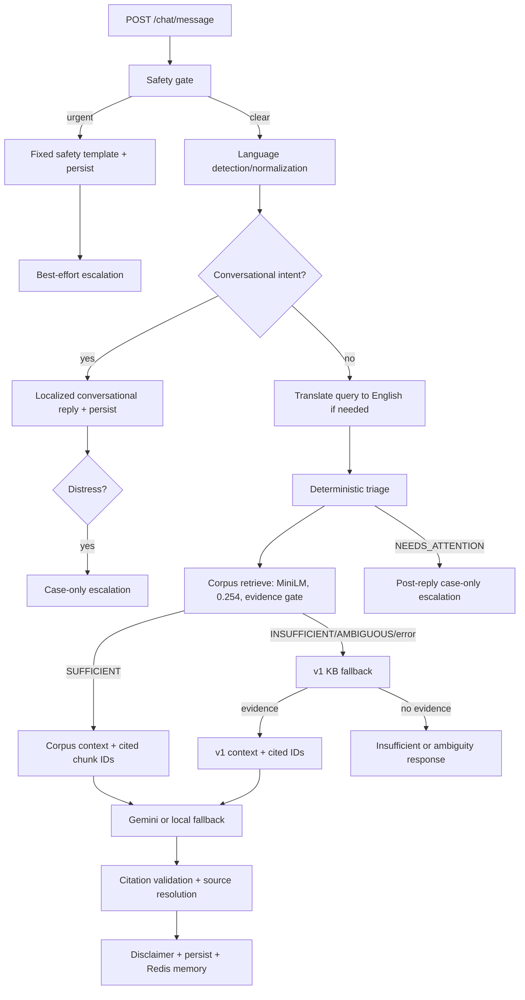

# RAG Architecture

> **Verified:** 2026-10-21 against the uncommitted working tree. **Authority:** current source and data artifacts. **Status:** corpus-backed retrieval is now part of the served chat path; this is an engineering integration, not clinical validation.
>
> Historical statements in older versions of this file said “RAG v2 is unwired” and “RAG v1 is the sole served path.” Those statements are obsolete. The original audit findings are retained in §8 with a historical label.

## 1. Current Summary

NurtureHer serves a hybrid RAG path:

- **Corpus-first:** MiniLM retrieval over the indexed medical corpus, threshold-gated and evidence-gated.
- **v1 fallback:** the original eight-entry internal knowledge base is used when corpus evidence is unavailable, insufficient, or ambiguous.
- **Gemini generation:** optional; a local templated fallback is used without an API key.
- **Safety first:** urgent/crisis detection always precedes retrieval and generation.
- **Deterministic triage:** the LLM never decides emergency status.
- **Citation validation:** unknown/malformed markers are stripped and only retrieved IDs are resolved to source metadata.

There is no standalone `app/rag_v2/pipeline.py`. The served orchestration lives in `app/services/corpus_evidence.py` and `app/services/chat_service.py`.

No approval record for the v2-as-served integration was found in current documentation. Treat the integration as implemented but pending explicit review/approval, not as a clinically approved retrieval system.

## 2. Component Map

| Layer | File(s) | Responsibility |
| --- | --- | --- |
| HTTP | `app/api/routes/chat.py` | `/chat/message`, `/chat/voice`, `/chat/tts`, `/chat/history`; authentication required |
| Orchestration | `app/services/chat_service.py` | Safety, language, intent routing, triage, retrieval selection, generation, citation validation, persistence, escalation |
| Corpus bridge | `app/services/corpus_evidence.py` | Loads index, MiniLM query embedding, threshold retrieval, evidence gate, v1 fallback signal |
| Corpus components | `app/rag_v2/embeddings.py`, `store.py`, `retrieve.py`, `evidence.py`, `citations.py` | Embedding adapter, cosine store, threshold table, evidence verdicts, citation validation |
| v1 fallback | `app/rag/` | Eight internal English entries, MiniLM/FAISS-or-NumPy retrieval, prompt/context builders |
| Citation sources | `app/services/citation_sources.py` | Resolve valid retrieved IDs to internal/corpus metadata |
| Safety | `app/services/safety.py` | Urgent/crisis phrase matching and fixed templates |
| Triage | `app/services/triage.py` | Deterministic ROUTINE / NEEDS_ATTENTION / URGENT classification |
| Conversational routing | `app/services/conversation_router.py` | Narrow non-medical intent short circuit |
| Translation | `app/services/translation_service.py`, `gemini_service.py` | Language normalization and best-effort English query translation |
| Generation | `app/services/gemini_service.py` | Model fallback chain or local templated response |
| Memory | `app/services/memory_service.py` | Redis chat memory, 20 messages, 1-hour TTL |
| Escalation | `app/services/escalation.py` | High-risk case creation, cooldown, SMS/notification policy |
| Ingestion | `scripts/ops/ingest_medical_corpus.py` | PDF extraction, provenance validation, chunking, embeddings, manifest |
| Artifacts | `data/rag_index/` | `chunks.json`, `vectors.npy`, `manifest.json`, `quarantine.json` |

Import direction:

```text
chat_service
  -> corpus_evidence -> rag_v2 (embeddings, store, retrieve, evidence)
  -> rag (v1 fallback, prompt/context)
  -> citation_sources -> rag (internal metadata) + corpus_evidence (corpus metadata)
```

`app/rag/` does not import `app/rag_v2/`. The bridge is a service-layer dependency, not a direct v1→v2 import.

## 3. Served Flow



Urgent safety detection happens before language resolution so a crisis phrase is never delayed by translation. Escalation is best-effort after the reply is persisted and cannot change the urgent template.

## 4. Corpus Path

### Retrieval

- Index artifacts: 1,167 chunks from 5 eligible documents; 6 documents total with 1 quarantined.
- Embedding: `sentence-transformers/all-MiniLM-L6-v2`, 384 dimensions.
- Similarity: normalized cosine similarity via `CosineStore`.
- Candidate count: top 4.
- Minimum score: `0.254` from the manifest default; fallback to `app/rag_v2/thresholds.json`.
- Evidence gate: `EvidenceGate(min_score=threshold, ambiguity_margin=0.05)`.
- Sufficient evidence: cited IDs and formatted context are passed to generation.
- Ambiguity: top contenders from different topics within the margin produce AMBIGUOUS; the caller falls back to v1.
- Unavailable index: `CorpusUnavailableError`, treated as no corpus evidence.

Topic identity for ambiguity favors chunk section, then the document's first topic, then the document ID.

### Corpus limits

- Source `review_status: approved` means approved for indexing, not clinically approved for chatbot use.
- PCOS coverage is thin; maternal sleep has a known evidence gap.
- Multilingual retrieval is uneven; non-English benchmark labels are largely provisional.
- Retrieval relevance does not establish factual or clinical correctness.
- The corpus/index directory is outside Git and Docker build context unless explicitly packaged.

## 5. v1 Fallback

The v1 path remains in `app/rag/`:

- Eight hardcoded English knowledge entries with IDs such as `safety_urgent_001` and `cycle_tracking_001`.
- Each entry says it is unverified and pending clinical review.
- MiniLM embeddings; FAISS `IndexFlatIP` with NumPy fallback.
- `top_k=4`, minimum score `0.30`.
- Degraded embedding/vector store is treated as no evidence.
- Used whenever corpus retrieval is unavailable, insufficient, ambiguous, or raises.

The v1 path is not a separate final answer authority. It is a fallback and is explicitly marked unverified.

## 6. Generation, Citations, and Sources

- Gemini: configured model first, then a fallback chain; temperature 0.3; max 512 tokens; 20-second timeout.
- `gemini-3.6-flash` and several legacy names are normalized to `gemini-3.5-flash-lite` in code.
- Without a key, `_fallback_response()` creates a templated answer from retrieved context. It uses the same source markers but is not live model output.
- The prompt instructs the model to use only cited IDs and educational, non-diagnostic language.
- `validate_citations()` strips unknown/malformed source markers and deduplicates the report. When any markers are stripped, the cleaned text is persisted.
- Citation validation checks whether IDs were retrieved; it does not prove that prose is grounded in the cited passage. `text_grounding_established` remains false.
- `resolve_citation_sources()` resolves only IDs present in the validated response and retrieved set:
  - internal v1 entries → internal metadata;
  - corpus chunk IDs → title, page, section, publisher, publication date from the index.
- Unknown/unindexed IDs are omitted rather than assigned guessed metadata.

## 7. Safety, Triage, and Escalation

### Safety

- `safety-templates-v1`, `pending-clinical-review`.
- Self-harm is checked before urgent medical.
- Phrase lists cover six languages but are initial drafts.
- Crisis templates are English-only by design.
- Substring matching has no negation handling; a denial can still trigger.
- On a hit: fixed template, persist, then best-effort escalation.

### Triage

- `chat-triage-v1`, `pending-clinical-review`.
- URGENT delegates to the safety phrase lists.
- NEEDS_ATTENTION matches conservative distress phrases; opens a moderate case without notifications.
- ROUTINE does not escalate.
- Triage is separate from retrieval relevance.

### Escalation

- Doctor recipient: active `DoctorPatient` link.
- Caregiver recipients: approved CareCircle access with emergency or risk sharing.
- 24-hour cooldown reuses an open `chat_triage` case.
- NEEDS_ATTENTION is case-only; URGENT queues notifications.
- SMS text can include the mother's name and up to 500 characters of the trigger excerpt. Treat it as sensitive.
- Missing doctor/phone is recorded explicitly, not silently dropped.
- Provider behavior: simulated without credentials in non-production; fail-closed in production; real delivery requires worker/beat.

## 8. Historical Audit Findings (Preserved)

The following findings were recorded in an earlier v2 audit. Some were subsequently remediated in the working tree; they are retained as historical evidence and must be rechecked before being treated as current defects.

- **Threshold validation:** malformed/missing thresholds could raise raw `TypeError`/`ValueError`; NaN/infinite values had untested behavior.
- **Store validation:** shape checks were weak for some dimension/1-D cases; NaN/inf query vectors could propagate; `k` type/range handling was not uniformly validated.
- **Evidence gate:** the original gate had no absolute score floor; weak scores could be treated as sufficient. The current gate accepts `min_score`, and the corpus bridge supplies the calibrated threshold.
- **Citation parsing:** an unclosed `[source:` could consume the rest of the text; malformed spans could consume neighboring prose; near-miss marker variants were untested.
- **Isolation:** v2 originally had no orchestrator and no production imports; components were exercised only by tests/scripts.
- **Approval:** a proposed “keep v2 isolated until separately approved” decision was recorded. The current working tree integrates v2 components into the served corpus path through `corpus_evidence.py`; no matching approval artifact was found in the current docs.
- **Fallback:** v1 was the only served path during the audit. It is now the fallback.

Historical benchmark figures (MiniLM/MPNet, recall, latency, provisional labels) remain in [`rag_v2_benchmark_report.md`](./rag_v2_benchmark_report.md) and [`rag_v2_thresholds.md`](./rag_v2_thresholds.md). They are dated evidence, not current production measurements.

## 9. Evaluation Status

- Corpus construction and manifest: verified from current artifacts (6 documents, 5 eligible, 1 quarantined, 1,167 chunks, 98 bibliography chunks dropped, 384-d, 0.254).
- Targeted tests: previously reported 70 passed (RAG/safety/privacy subset); not rerun in this documentation pass.
- Full suite, live Gemini, and complete multilingual evaluation: unverified.
- Clinical/native review: pending.
- No clinical validation, diagnostic accuracy, or safety certification is claimed.

## 10. Architectural Boundaries

1. Source code and artifacts are authoritative; this file is not a substitute for reading them.
2. Corpus evidence is bounded by the indexed sources and retrieval threshold.
3. A citation is traceability metadata, not proof of clinical correctness.
4. A SUFFICIENT verdict is a retrieval decision, not a medical judgment.
5. Safety and triage rules are deterministic drafts pending review.
6. Do not change thresholds, safety phrases, or corpus content as an unreviewed hotfix.
7. Do not claim that the v1 fallback is clinically reviewed.
8. Do not expose trigger excerpts, patient data, or SMS bodies in documentation or logs.

## 11. Related Documents

- [`RAG_RUNBOOK.md`](./RAG_RUNBOOK.md)
- [`IMPLEMENTATION_STATUS.md`](./IMPLEMENTATION_STATUS.md)
- [`AUTH_AND_RBAC.md`](./AUTH_AND_RBAC.md)
- [`corpus_eval_report.md`](./corpus_eval_report.md)
- [`rag_v2_benchmark_report.md`](./rag_v2_benchmark_report.md)
- [`rag_v2_thresholds.md`](./rag_v2_thresholds.md)
