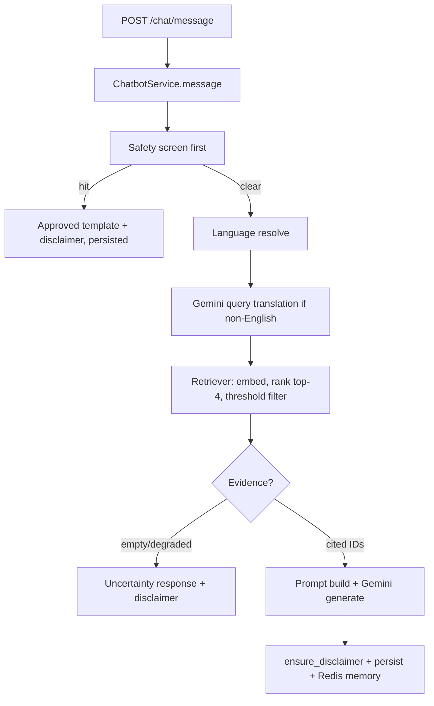

# NurtureHer RAG Architecture

> Evidence tiers used in this document: **verified-in-repo** (read from source during audits), **verified-via-git** (not applicable — single-commit history; working tree inspected instead), **previously-reported** (session history, not re-run here), **planned** (approved but not implemented). Nothing here claims clinical validation.

## Table of contents

1. [RAG v1 — existing implementation](#31-rag-v1--existing-implementation)
2. [RAG v2 — experimental implementation](#32-rag-v2--experimental-implementation)
3. [Embedding models and retrieval](#33-embedding-models-and-retrieval)
4. [Datasets and benchmark evaluation](#34-datasets-and-benchmark-evaluation)
5. [RAG v1 versus RAG v2](#35-rag-v1-versus-rag-v2)
6. [RAG v2 audit findings](#36-rag-v2-audit-findings)
7. [RAG integration gap](#37-rag-integration-gap)
8. [Approved design decisions](#38-approved-design-decisions)
9. [Proposed remediation roadmap (NOT IMPLEMENTED)](#39-proposed-remediation-roadmap-not-implemented)

---

## 3.1 RAG v1 — existing implementation

**Status:** verified-in-repo; sole served RAG path. No production code imports `app/rag_v2/` (verified by grep during integration audit).

### Entry points and callers

- HTTP entry: `POST /api/v1/chat/message`, `POST /api/v1/chat/voice`, `GET /api/v1/chat/history` in `app/api/routes/chat.py` (prefix `/chat`, JWT `get_current_user`, no role gate — any authenticated role may chat; identity comes from the token, never from request fields).
- Service orchestrator: `ChatbotService.message()` in `app/services/chat_service.py` (aliased as `ChatService` in `app/services/health.py:59`).
- Frontend caller: `frontend/src/pages/Coach.tsx` (`api.sendChat(text, language)`, `api.chatHistory()` in `frontend/src/lib/api.ts:214-215`); read-only history view in `SupportPages.tsx` (`ChatHistoryPage`).

### Request-to-response flow (verified)

1. **Safety first** (`app/services/safety.py:detect_urgent_symptoms`): self-harm and urgent-medical phrase lists (6 languages); on hit returns an approved template immediately, skipping retrieval/generation. Templates marked `REVIEW_STATUS="pending-clinical-review"`; crisis templates English-only by design.
2. **Language resolve** (`app/services/translation_service.py`): Unicode-block + keyword detection (`detect_language`), allowlist normalization; Romanized input detects as `None` → falls back to request field/profile language.
3. **Query translation** (`app/services/gemini_service.py:translate_to_english`, temp 0.0, 10s timeout): best-effort; any failure falls back to the original query with a log line (languages only, never query text).
4. **Retrieval** (`app/rag/retriever.py:42` — `top_k=4, min_score=0.30` default): FAISS `IndexFlatIP` over L2-normalized MiniLM vectors (= cosine in [-1,1]); hash/NumPy fallback forced to no-evidence when degraded; diagnostics carry scores/counts/backend only.
5. **Context** (`app/rag/context_builder.py`): retrieved lines as `- [<id>] <title>: <content>` plus per-user DB snapshot (name, language, age, pregnancy status, delivery date, location, latest mood/symptoms/cycle/PCOS risk+probability/PPD risk+EPDS). All queries filtered by `user_id` from JWT.
6. **Prompt** (`app/rag/prompt_templates.py`): safety prompt (educational-only, no diagnosis/prescription, escalate to doctor/professional), `Respond in {language}` (covers `ml`), cite-only-retrieved-IDs rule, `ensure_disclaimer()` appends `It may make mistakes, so please take care.` idempotently; deterministic uncertainty builder for no-evidence.
7. **Generation**: `GeminiService.generate_response` (temp 0.3, 512 tokens, 20s timeout, 4-model fallback chain) or regex-based templated `_fallback_response` with real `[source:<id>]` markers only.
8. **Persist**: `ChatRepository.create` + commit; Redis `chat-memory:{user_id}` (20 turns, 1h TTL, fail-open).

### Modules (`app/rag/`, 9 files)

| File | Responsibility |
|---|---|
| `__init__.py` | Re-exports builder + retriever |
| `knowledge_base.py` | 8 hardcoded English entries with stable IDs; each carries `source="NurtureHer internal knowledge entry (unverified — pending clinical review)"` |
| `document_loader.py` | Maps entries to `Document` with id/category/title/language/source metadata |
| `documents.py` | `Document` dataclass (langchain import with local fallback) |
| `embedding.py` | `all-MiniLM-L6-v2`, 384-d, normalized; `is_degraded` flag on load failure |
| `vector_store.py` | FAISS `IndexFlatIP` + NumPy fallback; `backend` name reporting |
| `retriever.py` | `RetrievalDiagnostics`, `RetrievalResult` (`cited_ids`, `has_evidence`), `ThresholdTable`, `MissingThresholdError`, `Retriever` |
| `context_builder.py` | Retrieval formatting + user snapshot; exposes `last_diagnostics`, `cited_ids` |
| `prompt_templates.py` | `LANGUAGE_NAMES` (incl. `ml`), disclaimer helper, safety prompt, builders |

### Error handling and fallbacks
Missing API key → templated fallback; translation failure → original query; degraded embeddings → no-evidence path; Redis failure → empty history, flow continues; all safe paths still append the disclaimer. No exception escapes `message()` for these degradations (verified-in-repo).

### Tests (v1 chat)
`tests/test_chat_safety.py` (detection 6 langs, precedence, emergency bypass), `tests/test_chat_pipeline.py` (disclaimer, citations, evidence gating, translation fallback, isolation), `tests/test_chat_eval.py` (offline eval incl. retrieval relevance/refusal/crisis/language), `tests/test_chat_eval_live.py` (double-gated skip — never runs without approval).

### Known limitations
8 English-only docs; Romanized queries unhandled; ta/te/ml browser speech maps to en-IN; no threads/sessions (single per-user stream); sentiment lexicon English-only; voice endpoints are mock stubs (deferred).

---

## 3.2 RAG v2 — experimental implementation

**Status:** verified-in-repo as isolated, unwired code. `app/rag_v2/` is imported only by its own tests and `scripts/ops/*`; zero imports to/from `app/rag/` or production paths (verified by grep).

| File | Responsibility (verified) |
|---|---|
| `schemas.py` | `SourceProvenance` (publisher, url-or-path, dates, `pending\|approved`), `MedicalDocument`, `Chunk`, `ValidationIssue/Result`, deterministic `CorpusManifest.to_text()` |
| `ingest.py` | `clean_text`, `record_language` (metadata only), sliding-window `chunk_text`, `validate_document` (quarantines missing id/title/body, unsupported language, missing/incomplete provenance, non-approved status), `validate_corpus` → eligible + quarantined + manifest |
| `embeddings.py` | `EmbeddingBackend` (pinned `revision`, load-time, dimension check); `ModelUnavailableError` on any load failure — never substitutes; `minilm_backend()`, `mpnet_backend(model_path?)` |
| `store.py` | `CosineStore`: brute-force cosine over normalized vectors; validates 2-D numeric shape, non-zero vectors, query dims; `rank()` returns `(id, score)` best-first |
| `retrieve.py` | `ThresholdTable` (fail-closed `MissingThresholdError`), `Retriever` (top-k + threshold + optional category scope), `RetrievalDiagnostics/Result` |
| `evidence.py` | `EvidenceGate.decide()` → `SUFFICIENT/INSUFFICIENT/AMBIGUOUS`; ambiguity = competing *topics* within margin (default 0.05); clarification question carries no medical content |
| `citations.py` | `validate()` — single-pass regex; keeps valid markers, strips unknown/malformed, dedupes report; `text_grounding_established` always `False` |
| `benchmark.py` | `BenchmarkBackend` protocol, `SyntheticBackend`, `run_benchmark` (latency/tracemalloc), strict `recall_at_k` (ties don't count), `mrr()`, `recall_by_language()` |
| `cases.py` | 44 `LabeledCase`s; EN established (`provisional=False`), all non-English/Romanized `provisional=True` |
| `thresholds.json` | `{"minilm": {"default": 0.254, ...}, "mpnet": {"default": 0.35, ...}}`, `per_category: {}` |
| `scripts/ops/run_rag_v2_benchmark.py` | Local-only comparison runner → `docs/rag_v2_benchmark_report.{md,json}` |
| `scripts/ops/calibrate_rag_v2_thresholds.py` | Offline scorer → `thresholds.json` + `docs/rag_v2_thresholds.md` |

Current limitations: no orchestrator (see §3.7); no production index builder; MPNet loads from a machine-local manual dir on hosts without hub symlink privileges (recorded in report).

## 3.3 Embedding models and retrieval

| | MiniLM (v1 baseline) | MPNet (v2 candidate, NOT served) |
|---|---|---|
| Identifier | `sentence-transformers/all-MiniLM-L6-v2` | `sentence-transformers/paraphrase-multilingual-mpnet-base-v2` |
| Revision | `1110a243fdf4706b3f48f1d95db1a4f5529b4d41` (previously reported, in benchmark report) | `4328cf26390c98c5e3c738b4460a05b95f4911f5` (previously reported) |
| Dimension | 384 | 768 |
| Normalization | L2-normalized, cosine in [-1,1] | Same contract enforced (`CosineStore` re-normalizes) |
| Loading | Cached HF weights; `is_degraded` on failure | Pinned revision; `ModelUnavailableError` on failure (no hash fallback) |
| Downloads | At setup (cached) | One-time approved download; runtime never downloads |
| Threshold source | v1 default 0.30 | Generated `thresholds.json` (0.254 / 0.35) |
| Degraded behavior | Hash fallback forced to no-evidence | Hard failure, reported clearly |

Capabilities vs results are separated below; numbers are previously reported, not re-measured in this task.

## 3.4 Datasets and benchmark evaluation

- **Corpus:** the 8 v1 KB entries (stable IDs `safety_urgent_001` … `cycle_tracking_001`); no new medical content created.
- **Labels:** 44 cases in `cases.py` — 6 established EN, 34 provisional non-English/Romanized, 4 irrelevant controls. Provisional labels are explicitly unreviewed; metrics computed on them are reported separately.
- **Metrics implemented:** strict `recall@{1,4}`, `mrr()`, `recall_by_language()`, latency median/p95, tracemalloc peak KB, load ms.
- **Previously reported results** (historical — thresholds.json values re-verified present, scores not re-run here): MiniLM recall@1/4 ≈ 0.182, MRR ≈ 0.398; MPNet recall@1/4 ≈ 0.636, MRR ≈ 0.804; per-language tables in `docs/rag_v2_benchmark_report.md`; calibration cutoffs 0.254/0.35 from clean gaps ([0.073,0.435] / [0.149,0.551]), 6 relevant + 4 irrelevant samples each.
- **Limitations:** tiny sample; provisional labels; topical-relevance only; CPU timings machine-specific; tracemalloc misses native torch allocations. Retrieval scores do not establish factual correctness, safety, or clinical validation.

## 3.5 RAG v1 versus RAG v2

| | v1 (`app/rag/`) | v2 (`app/rag_v2/`) |
|---|---|---|
| Purpose | Served production chatbot path | Experimental, offline-evaluated successor |
| Maturity | Working end-to-end (safety→retrieve→generate→persist) | Components only; no orchestrator |
| Callers | Chat routes/services, eval scripts | Tests + ops scripts only (verified: no production imports) |
| Embeddings | MiniLM served; degraded→no-evidence | MiniLM + MPNet adapters; missing model raises |
| Safeguards | Threshold + uncertainty + disclaimer + citations-in-prompt | + evidence gate, citation validator, provenance gating |
| Testing | Safety/pipeline/eval/live-gated suites | Ingest/retrieval/evidence/citations/benchmark suites |
| Limits | EN-only KB, no threads, mock voice | Unwired; provisional labels; pending review |
| Production status | **Served** | **Not served; must stay isolated until approved** |

Integration audit finding (verified, stands): no production code, route, service, or script chains v2 stages together; components exercised independently; `app/rag/` imports nothing from v2 and vice versa. No discrepancy found on re-verification of import graphs.

## 3.6 RAG v2 audit findings (preserved)

### `retrieve.py`
Missing backend → `MissingThresholdError` (tested); missing default → same (untested); malformed entries → `MissingThresholdError` *or* raw `TypeError` for non-dict `per_category` (untested); non-numeric → raw `ValueError`/`TypeError` escape (untested); NaN → silent total filtering (untested); `+inf` → empty, **`-inf`/below-`-1` → filtering disabled, fail-open** (untested); out-of-range `[−1,1]` unchecked (generated-file shape only); per-category values unreachable from `retrieve()` (calls `get(name)` without category — verified); missing regression tests for all of the above.

### `store.py`
Shape check is tautological for the dimension axis; 1-D/0-d inputs raise raw `IndexError`, non-numeric dtype raw `TypeError` (both untested); ±inf vectors pass validation then poison the store with NaN (untested); NaN docs rejected incidentally, NaN/inf queries propagate NaN scores silently (untested); `k=0`/negative → `[]` (benign, untested), non-integer `k` → `TypeError` (untested). Covered: zero vectors, row-count mismatch, query dim mismatch, zero-norm query, ordering, `k>n` (`test_cosine_score_semantics`, `test_ranking_order_and_k`, `test_store_rejects_bad_inputs` in `tests/test_rag_v2_retrieval.py`).

### `evidence.py`
Empty → INSUFFICIENT (tested: `test_evidence_empty_result_is_insufficient`); clear winner → SUFFICIENT, 2-topic tie → AMBIGUOUS, same-topic tie → SUFFICIENT (tested: `test_evidence_sufficient_clear_winner`, `test_evidence_ambiguous_competing_topics`, `test_evidence_same_topic_near_tie_is_sufficient`, `test_clarification_with_topic_labels`); **no absolute-score floor** — weak/NaN scores can yield SUFFICIENT (untested); no finiteness checks (untested); margin unvalidated — negative/NaN margin disables ambiguity, string margin raises `TypeError` (untested); ordering assumed not verified (untested); unknown topics silently ignored (untested); 3+-topic truncation to 2 (untested).

### `citations.py`
Valid/fabricated/duplicate/empty markers handled and tested (`test_valid_markers_pass_through`, `test_fabricated_ids_stripped_prose_preserved`, `test_malformed_markers_stripped`, `test_empty_and_markerless_text`, `test_duplicate_valid_markers_kept_with_deduped_report` — all in `tests/test_rag_v2_citations.py`); **unclosed `[source:` deletes to end-of-string**; malformed spans consume neighboring prose (acknowledged in-test); near-miss variants (`[source :x]`, `[Sources:x]`) pass through; `None` inputs raise `TypeError` (all untested).

Each finding classified: code-inspected behavior, with test names where covered; unexecuted edge cases marked untested, not assumed.

## 3.7 RAG integration gap
No orchestrator exists — the intended `pipeline.py` (embed → threshold-gated retrieve → evidence gate → SUFFICIENT/INSUFFICIENT/AMBIGUOUS handling → citation validation → structured outcome) is **a proposal, not implemented**. Until it exists, verdicts have no consumer and stripped-citation outcomes have no handler. A sufficient verdict must never be read as factual/clinical grounding.

## 3.8 Approved design decisions (user-approved, preserved)
1. Unclosed `[source:` strips only the opener, prose preserved.
2. Evidence gate enforces a minimum-score floor (not ranking alone).
3. Floor respects backend-specific calibration; no universal threshold; calibrated values unchanged without evaluation evidence.
4. RAG v2 stays experimental and isolated from v1/production until separately approved.
5. No remediation implementation approved yet (as of this writing).

Open questions: clarification-copy sign-off (UX, not clinical); per-category thresholds if gaps diverge; transliteration strategy for Romanized queries.

## 3.9 Proposed remediation roadmap (NOT IMPLEMENTED)
- **Phase A** — threshold config validation (`retrieve.py` + tests): finite/range/type checks, `MissingThresholdError` everywhere invalid.
- **Phase B** — store/query validation (`store.py` + tests): ndim/dtype/finiteness checks, integer `k` validation.
- **Phase C** — evidence-gate hardening (`evidence.py` + tests): finiteness gate, score floor, margin validation, order-normalization, unknown-topic policy.
- **Phase D** — citation parsing (`citations.py` + tests): opener-only unclosed handling, near-miss policy, `None` handling.
- **Phase E** — `pipeline.py` + integration tests wiring retrieve→gate→validate with explicit verdict handling.
- **Phase F** — full suite + coverage gate + Ruff + v1-isolation proof (import-graph grep both directions).
Each phase requires: files, behavior, regression tests, acceptance criteria, risks — none started.
