# NurtureHer ER Diagram (Partial)

> Partial core/care-sharing view, verified 2026-10-21. It is not an exhaustive schema; see `app/models/` and Alembic migrations for every table and constraint. Do not infer production readiness or clinical meaning from this diagram.

```mermaid
erDiagram
  users ||--o| mother_profiles : has
  users ||--o{ moods : records
  users ||--o{ symptoms : records
  users ||--o{ cycles : tracks
  users ||--o{ journals : writes
  users ||--o{ pcos_predictions : receives
  users ||--o{ ppd_assessments : completes
  users ||--o{ chat_messages : sends
  users ||--o{ high_risk_cases : flagged
  users ||--o{ alerts : receives
  users ||--o{ refresh_tokens : owns
  users ||--o{ audit_logs : performs
  users ||--o{ carecircle_qrs : generates
  users ||--o{ carecircle_access : owns
  users ||--o{ carecircle_access : requests
  users ||--o{ doctor_patients : doctor
  users ||--o{ doctor_patients : patient
  users ||--o{ doctor_notes : writes
  users ||--o{ doctor_notes : receives
  users ||--o| nutrition_profiles : has
  users ||--o{ hydration_logs : logs
  users ||--o{ nutrition_care_plans : receives

  users {
    uuid id PK
    string name
    string email UK
    string phone
    string role
    string preferred_language
    boolean is_verified
    boolean is_active
    datetime created_at
    datetime updated_at
    datetime deleted_at
  }

  mother_profiles {
    uuid id PK
    uuid user_id FK
    int age
    float weight
    float height
    string district
    string village
    datetime created_at
    datetime updated_at
    datetime deleted_at
  }

  carecircle_qrs {
    uuid id PK
    uuid user_id FK
    string token UK
    datetime expires_at
    datetime created_at
  }

  carecircle_access {
    uuid id PK
    uuid user_id FK
    uuid requester_id FK
    string relationship_label
    string status
    boolean share_emergency
    boolean share_risk_category
    boolean share_wellness_summary
    boolean share_doctor_notes
    boolean share_nutrition
    boolean share_chat_history
    datetime requested_at
    datetime responded_at
    datetime revoked_at
  }

  doctor_patients {
    uuid id PK
    uuid doctor_id FK
    uuid patient_id FK
    string status
    datetime created_at
  }

  doctor_notes {
    uuid id PK
    uuid doctor_id FK
    uuid patient_id FK
    text clinical_observations
    text follow_up_recommendation
    text prescribed_advice
    datetime created_at
  }

  nutrition_profiles {
    uuid id PK
    uuid user_id FK
    json dietary_preferences
    json dietary_restrictions
    json allergies
    boolean breastfeeding
  }

  hydration_logs {
    uuid id PK
    uuid user_id FK
    date log_date
    int cups
    int target_cups
  }

  nutrition_care_plans {
    uuid id PK
    uuid mother_id FK
    string title
    json applicable_context
    json meals
    string source
    string status
    int version
    uuid created_by_id FK
    uuid reviewer_id FK
    datetime reviewed_at
    uuid archived_by_id FK
    datetime archived_at
  }

  high_risk_cases {
    uuid id PK
    uuid user_id FK
    string risk_type
    string risk_level
    uuid assigned_worker_id FK
    string status
    datetime created_at
    datetime updated_at
    datetime deleted_at
  }

  alerts {
    uuid id PK
    uuid user_id FK
    text message
    string sent_status
    datetime sent_at
    datetime created_at
    datetime updated_at
    datetime deleted_at
  }

  refresh_tokens {
    uuid id PK
    uuid user_id FK
    string token_jti UK
    datetime expires_at
    datetime revoked_at
  }
```

## Relationship Notes

- `carecircle_access` has two user relationships: the mother (`user_id`) and the requester (`requester_id`).
- Doctor portal authorization uses approved, unrevoked `carecircle_access`, not `doctor_patients`. `doctor_patients` is used for escalation targeting.
- `nutrition_care_plans` has separate creator, reviewer, and archiver user references.
- `high_risk_cases.assigned_worker_id` is retained for schema compatibility after ASHA removal; it is not evidence of a current ASHA role.
- `share_emergency`, `share_risk_category`, and `share_wellness_summary` have database defaults of true, but new API access requests explicitly initialize all scopes to false. Approval API defaults are described in [`AUTH_AND_RBAC.md`](./AUTH_AND_RBAC.md).
